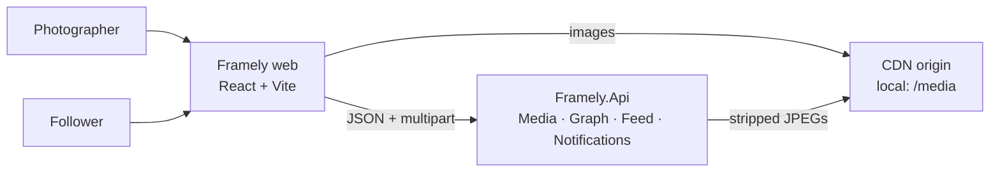

# Framely

A photo-first social app for Lumen Collective (fictional), a network of 4,000 South African photographers. Photographers post a photo with a caption; their followers see it first in a quiet, ad-free home feed.

## Design at a glance
**Brief.** Local photographers have no photo-first community of their own. Framely gives them a home feed of the people they follow, newest first, opening in under 1 s on 4G, with location data stripped from photos unless they opt in (POPIA).

**Architecture.** A modular monolith (Media, Graph, Feed, Notifications) with a pre-built home feed per follower (fan-out on write) as its read model, and images served from blob storage behind a CDN. Members read about 50x more than they post, so each feed read is one keyset lookup; three engineers run one deployable instead of four services. The module boundaries match the future services and are enforced by tests. ADR-0001's trigger: split Feed and Media into services when fan-out delays posting by more than 2 s at p95, or an account passes ~100k followers (then pull for those accounts). Full reasoning, options table, diagrams and capacity numbers: [`docs/DESIGN.md`](docs/DESIGN.md).




## Run it in GitHub Codespaces

[](https://codespaces.new/Legion91919/framely?quickstart=1)

The dev container installs the SDKs, restores packages and runs every test once on first start. The same setup works locally with VS Code's Dev Containers extension.

| What | Command | Port |
|---|---|---|
| API (Framely) | `ASPNETCORE_ENVIRONMENT=Development ASPNETCORE_URLS=http://0.0.0.0:5101 dotnet run --project src/Framely.Api` | 5101 |
| Web app | `cd web && npm run dev` | 5181 |
| All tests (same as CI) | `scripts/test-all.sh` | - |

## What it does today (slice 1)
- Home feed: photo cards (author, place, caption, time), 25 per page with an opaque cursor, loading / empty / error states.
- Post a photo: compose dialog (JPEG up to 10 MB, caption, alt text) sends `multipart/form-data` with an `Idempotency-Key`; the API checks size and type, sniffs the bytes, strips EXIF/XMP (APP1) unless location sharing is on, stores the file and fans the post out to every follower's feed.
- Follow / unfollow photographers (back-fills or removes their posts) and an in-app notification for the followed member.
- Demo identity: a "Viewing as" switcher (header `X-Member-Id`) with invented seed data and SVG placeholder photos.

## Run locally
```bash
ASPNETCORE_ENVIRONMENT=Development dotnet run --project src/Framely.Api   # API on http://localhost:5101
cd web && npm ci && npm run dev                                           # web on http://localhost:5181
```
Tests, configuration and incidents: `.agentic/runbook.md`.

## How this project is organised
- `src/Framely.Api`: composition root (endpoints, workflows, ProblemDetails, health, seed).
- `src/Modules/<Module>/Framely.<Module>`: Media, Graph, Feed, Notifications. Internals stay `internal`.
- `tests/Framely.Tests`: unit, real-HTTP acceptance and architecture tests.
- `web/`: React + Vite + TypeScript client, Vitest tests.
- `.agentic/`: project knowledge (start with `.agentic/README.md`). AI agents read `AGENTS.md` first.

Built with the Baton model from the Agentic Engineering Kit: frame → map → decide → sketch → slice loop → pass the baton.
