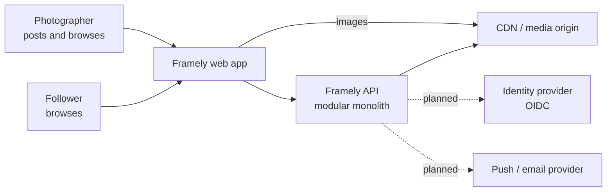
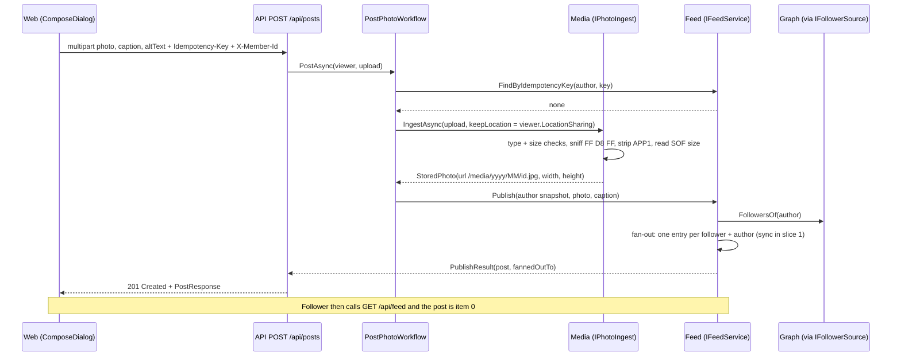
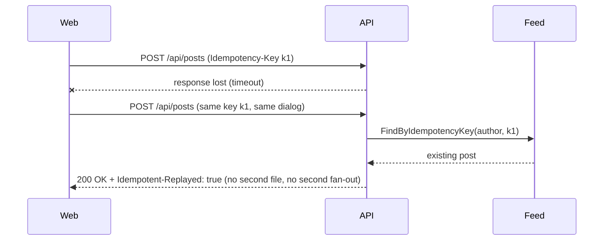
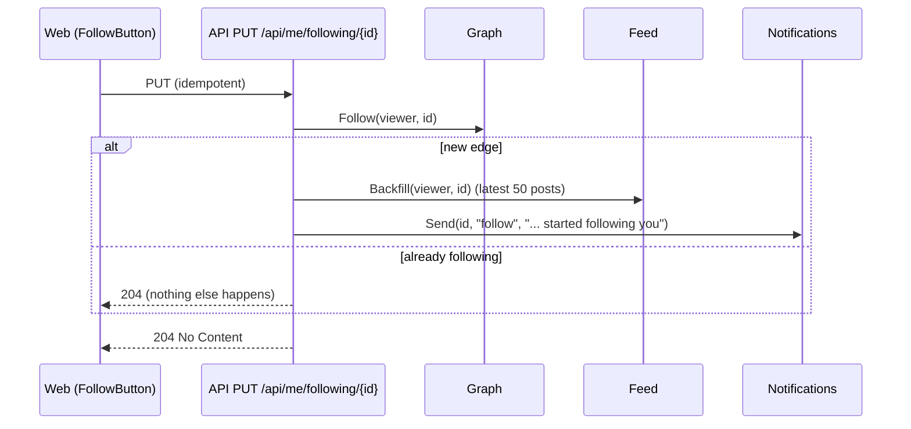
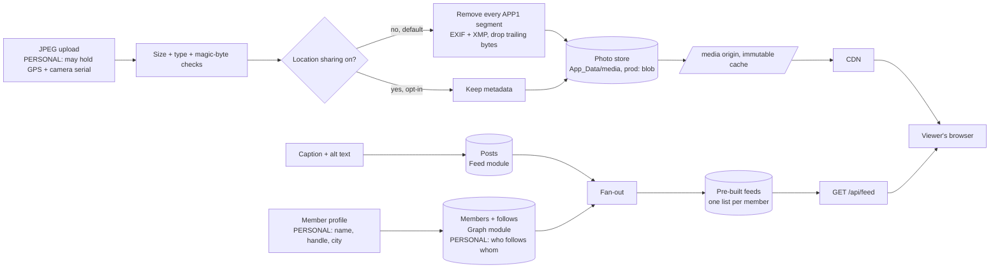
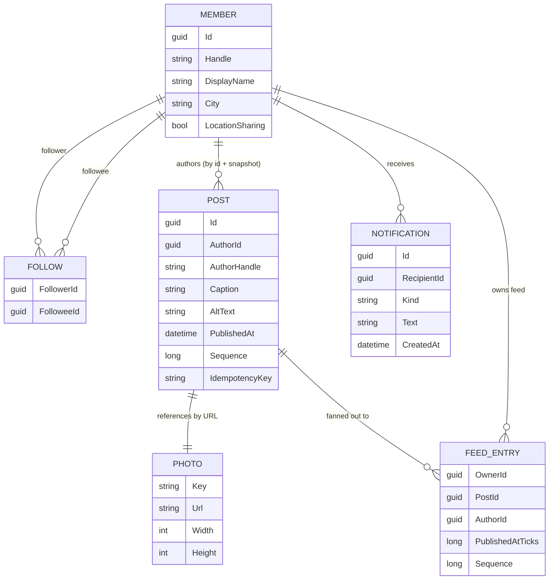

# Framely design dossier

> Showcase project. Lumen Collective is a fictional client; every name, member and number is invented.
> The design described here matches the slice 1 code (`src/`, `web/`). Things that are planned are marked **(planned)**.

## 1. Brief
- **Client:** Lumen Collective (fictional), a network of 4,000 South African photographers.
- **Problem:** local photographers have no photo-first community of their own. Big platforms bury their work under ads and video, and they can't see who actually follows their craft.
- **Users:** photographers (daily, mobile first, posting and browsing) and their followers (daily, browsing only).
- **Outcomes:** home feed opens in under 1 s on 4G; a new post reaches followers' feeds within 5 s; image bandwidth is served by a CDN, not the API.
- **Constraints:** POPIA. Location is stripped from photos unless the member opts in. Delete-my-account removes photos within 30 days.

## 2. Requirements
**Functional (slice 1, built):**
1. A photographer posts a JPEG with a caption (and alt text).
2. People who follow the author see it first in their home feed. People who don't, never see it.
3. The stored image has no GPS EXIF unless the author's location sharing is on.
4. The feed pages with a cursor, 25 per page, newest first.
5. Follow and unfollow photographers; the followed member gets a notification.

**Non-functional:**

| Concern | Target | Where it comes from |
|---|---|---|
| Feed latency | p95 API < 300 ms; screen usable < 1 s on 4G | product outcome, `quality.md` |
| Freshness | post visible to followers < 5 s (p95) | product outcome |
| Availability | 99.9 % monthly for read and post endpoints | `quality.md` |
| Upload | JPEG only, max 10 MB | `Media:MaxUploadBytes` |
| Privacy | location stripped by default (opt-in); erase photos within 30 days of account deletion | POPIA, product constraint |
| Retention | feed keeps the newest 1,000 entries per member; older posts stay on the author's profile | `Feed:MaxTimelineLength` |

## 3. Capacity estimate (launch)
Assumptions (rounded up on purpose):
- 20,000 members: 4,000 photographers + 16,000 followers. 50 % daily active = 10,000 DAU.
- Each active member opens the feed 8 times a day and reads 1.5 pages: **120,000 feed requests/day**.
- Average 1.4 req/s, peak 10x = **~15 feed req/s**. One API instance handles this easily.
- Posting: half the photographers post once a day: **2,000 posts/day** (the "50 reads per post" trait is the same order).
- Fan-out: an average photographer has ~150 followers: 2,000 x 150 = **300,000 feed writes/day** (~35/s at peak).
- Storage: 4 MB per original after stripping: 8 GB/day, **~3 TB/year** of originals in blob storage.
- Feed store: 40 bytes per entry x 1,000 entries x 20,000 members = **~0.8 GB** at the cap.
- Bandwidth: ~8 images actually seen per page at ~300 KB display size (planned renditions): 120,000 x 8 x 300 KB = **~290 GB/day, ~9 TB/month**. This is why images must come from a CDN, never through the API.

## 4. Options considered
`arch-advisor compare` with the launch traits (MediaDelivery, ReadHeavy, PersonalData, SeveralBusinessAreas, SmallTeam):

| Option | Fit | Complexity (1-5) | Main reason |
|---|---|---|---|
| Modular monolith + CQRS read models | Recommended | 3 | Matches the advisor's recommended style (ModularMonolith). |
| Modular monolith | Good alternative | 3 | Same family as the recommendation (ModularMonolith); a valid variant if its trade-offs suit the team. |
| Serverless functions + queues | Possible | 3 | Media: serve files from a CDN whatever the style. |
| Static site + serverless function | Poor fit | 1 | The product has real server-side behaviour and data; a static site can't hold it. |
| Layered monolith | Poor fit | 1 | Several business areas would tangle without module boundaries. |
| Vertical slice monolith | Poor fit | 2 | Several business areas would tangle without module boundaries. |
| Clean Architecture monolith | Poor fit | 2 | Several business areas would tangle without module boundaries. |
| Event-sourced core with CQRS | Poor fit | 4 | Event sourcing's cost isn't repaid without audit, money or replay needs. |
| Microservices (request/response) | Poor fit | 5 | A small team can't run a distributed system well (deployments, tracing, on-call). |
| Event-driven microservices | Poor fit | 5 | A small team can't run a distributed system well (deployments, tracing, on-call). |

Same tool with the global-scale traits (MediaDelivery, ReadHeavy, PersonalData, SeveralBusinessAreas, GlobalScale):

| Option | Fit | Complexity (1-5) | Main reason |
|---|---|---|---|
| Microservices (request/response) | Recommended | 5 | Matches the advisor's recommended style (Microservices). |
| Serverless functions + queues | Good alternative | 3 | Same family as the recommendation (Microservices); a valid variant if its trade-offs suit the team. |
| Event-driven microservices | Good alternative | 5 | Same family as the recommendation (Microservices); a valid variant if its trade-offs suit the team. |
| Modular monolith | Possible | 3 | Media: serve files from a CDN whatever the style. |
| Modular monolith + CQRS read models | Possible | 3 | Read-heavy: separate read models keep queries fast. |
| Static site + serverless function | Poor fit | 1 | The product has real server-side behaviour and data; a static site can't hold it. |
| Layered monolith | Poor fit | 1 | Several business areas would tangle without module boundaries. |
| Vertical slice monolith | Poor fit | 2 | Several business areas would tangle without module boundaries. |
| Clean Architecture monolith | Poor fit | 2 | Several business areas would tangle without module boundaries. |
| Event-sourced core with CQRS | Poor fit | 4 | Event sourcing's cost isn't repaid without audit, money or replay needs. |

**Why the winner won and the others lost:**
- **Modular monolith + CQRS read model (chosen).** Four business areas need hard boundaries, but three engineers need one deployable and one database. The pre-built home feed *is* the read model: the write side (posts) and the read side (per-follower feed entries) are separate, so reads stay a single keyset lookup however many follows exist.
- **Plain modular monolith.** Same family; without the pre-built feed, every feed read becomes "posts of everyone I follow, sorted" which gets slower with every follow and post (ADR-0001's rejected "feeds computed on read").
- **Serverless functions + queues.** Good for the fan-out worker and image renditions later (planned), but a whole product as functions is hard to test end to end and cold starts hurt the 1 s feed target.
- **Microservices / event-driven microservices.** The advisor's global-scale answer. Today they would triple the operational load (deployments, tracing, on-call) for ~15 req/s.
- **Layered / vertical slice / Clean monoliths.** No module boundaries, so Media, Graph, Feed and Notifications would tangle.
- **Event sourcing.** No audit, money or replay needs to repay the cost.

**Evolution trigger (ADR-0001):** split Feed and Media into services when fan-out work delays posting by more than 2 s at p95 (measured by the `framely.feed.fanout.duration` histogram), or when a single account passes ~100k followers (then switch those accounts to pull-based feeds).

## 5. Architecture
### C4 context


### C4 container
```mermaid
flowchart TB
  subgraph browser[Browser]
    spa[React + Vite SPA<br/>web/]
  end
  subgraph host[Framely.Api process]
    endpoints[Minimal API endpoints<br/>/api/feed /api/posts /api/members /api/me/*]
    wf[Workflows<br/>PostPhotoWorkflow, FollowWorkflow]
    media[Media module<br/>IPhotoIngest, JpegMetadataStripper]
    graph[Graph module<br/>IMemberDirectory, ISocialGraph]
    feed[Feed module<br/>IFeedService, IFeedStore]
    notif[Notifications module<br/>INotificationSender, INotificationInbox]
    origin[/media static origin/]
  end
  disk[(Local disk<br/>App_Data/media<br/>prod: blob storage)]
  mem[(In-memory stores<br/>prod: Postgres + feed cache)]
  spa -- JSON + multipart --> endpoints
  spa -- GET /media/... --> origin
  endpoints --> wf
  wf --> media & graph & feed & notif
  feed -- IFollowerSource adapter --> graph
  media --> disk
  origin --> disk
  graph & feed & notif --> mem
```

### Modules and contracts
| Module | Owns | Public contract | Calls |
|---|---|---|---|
| Media (`Framely.Media`) | upload policy, EXIF stripping, photo storage, the `/media` origin | `IPhotoIngest`, `MediaOptions`, `UseMediaOrigin()` | nothing |
| Graph (`Framely.Graph`) | members, privacy settings (location sharing), follow edges | `IMemberDirectory`, `ISocialGraph` | nothing |
| Feed (`Framely.Feed`) | posts, per-member pre-built feeds, cursors, idempotency keys | `IFeedService`; needs an `IFollowerSource` port | its own port only |
| Notifications (`Framely.Notifications`) | in-app inbox (stub) | `INotificationSender`, `INotificationInbox` | nothing |
| Api (`Framely.Api`) | composition, demo identity, ProblemDetails, health, workflows, seed | HTTP | all modules' public contracts |

Modules never reference each other. Cross-module work happens in the Api's workflows, and the Feed reaches followers through its own `IFollowerSource` port, implemented in the Api by `GraphFollowerSource`. `ArchitectureTests` fails the build if a module references another module's assembly or project, exposes internals to anything but the test assembly, or makes an `.Internal` type public.

## 6. Communication flows
### Slice 1: post a photo, followers see it first


### Riskiest flow: the client retries a post

The web app creates one key per open compose dialog and reuses it on every retry. `Feed.Publish` checks the key again inside its lock, so two racing requests still produce one post.

### Follow

Everything is synchronous and in-process in slice 1. **(planned)** With Postgres, `Publish` writes the post and an outbox row in one transaction; a fan-out worker reads the outbox and writes feed entries, so posting no longer waits for fan-out (keeps the 2 s trigger far away).

## 7. Data flow

There is no money in Framely. Personal data: profile (name, handle, city), the follow graph, photo metadata, and notifications.

## 8. Data model


| Entity | Owner module | Consistency |
|---|---|---|
| Member, Follow | Graph | strong (single writer, lock / one transaction) |
| Post, idempotency key | Feed | strong |
| Feed entry | Feed | eventual (written by fan-out after the post; slice 1 does it in the same request) |
| Author snapshot on post | Feed | eventual copy of Graph data (a renamed member shows the old name on old posts until a refresh job, planned) |
| Photo file | Media | strong write (temp file then atomic move), then immutable |
| Notification | Notifications | eventual, best effort |

## 9. Scaling path (what breaks first, in order)
1. **Image bandwidth** (~9 TB/month at launch). Blob storage + CDN in front from day one in production; the API's `/media` origin exists only to mimic it locally. Add resized renditions (planned) so feeds load ~300 KB images, not 4 MB originals.
2. **In-memory state** (slice 1): lost on restart and not shared between instances. Slice 2 moves Graph, posts and notifications to Postgres and feeds to a shared store (Postgres keyset table or a cache with sorted sets) behind the same interfaces.
3. **Fan-out latency.** Move fan-out to a background worker fed by an outbox. Watch `framely.feed.fanout.duration`.
4. **Hot accounts.** A member with ~100k followers makes every post 100k writes. Switch those authors to pull: their posts are merged into a follower's feed at read time (the reference "pull fallback").
5. **Read load.** Cache page 1 of each feed for a few seconds; add read replicas.
6. **Extract services.** When the ADR trigger fires, extract Feed and Media first: their contracts (`IFeedService`, `IPhotoIngest`, `IFollowerSource`) become HTTP/queue contracts.

## 10. Failure modes
| Failure | Effect | Mitigation |
|---|---|---|
| Client retries a post | duplicate post, duplicate fan-out | `Idempotency-Key` per member; replay returns 200 with the original post |
| Upload is huge or lies about its type | memory or disk abuse, stored non-images | request size limit, `MaxUploadBytes` check while streaming, magic-byte sniff, JPEG parser rejects malformed files (415/413) |
| Malformed JPEG crafted to break the parser | crash or infinite loop | stripper validates every segment length, never reads past the buffer, always advances; unit tests for truncated, bad-length, no-EOI and garbage input |
| Media disk/blob unavailable | posts fail | `/health/ready` checks the store is writable so traffic moves away; client keeps the dialog open to retry with the same key |
| Fan-out slow | posting slows | metric + ADR trigger; planned async worker |
| Hot key (very popular author) | huge fan-out, hot feed partition | pull fallback for big accounts (planned), timeline cap of 1,000 entries |
| Tampered or stale cursor | 500s, skipped posts | opaque versioned keyset cursor; invalid cursor = 400 ProblemDetails; keyset paging is stable while new posts arrive |
| Notification send fails | missing notice | best effort, never blocks a follow (planned outbox for push) |
| Region outage | site down | single region at launch (99.9 % SLO); CDN keeps serving cached images; backups restored to a second region per runbook (planned) |

## 11. Security and privacy
- **AuthN (slice 1):** demo identity via the `X-Member-Id` header, checked against known members (`RequireMemberFilter`, 401 ProblemDetails otherwise). **(planned)** OIDC bearer tokens; endpoints only call `HttpContext.Viewer()`, so the swap is in one place.
- **AuthZ:** a member can only act as themselves (`/api/me/...`); feed reads are always the viewer's own feed.
- **CSRF:** antiforgery is disabled on the upload endpoint because identity is a header, not a cookie. Re-enable it if cookie auth is ever added.
- **POPIA:** location sharing is off by default and opt-in (`PUT /api/me/settings/location-sharing`). All APP1 segments (EXIF and XMP) are removed unless opted in; bytes after the end-of-image marker are dropped too. Minimum data: no email or phone in slice 1. **(planned)** delete-my-account erases photos and feed entries within 30 days; access logging for personal data.
- **Uploads:** JPEG only, 10 MB, sniffed; files are stored under random names, served with `X-Content-Type-Options: nosniff`; storage keys can't escape the media root.
- **Errors:** RFC 9457 ProblemDetails; no stack traces leave the server.
- **Secrets:** none in slice 1; production secrets come from a vault, never `appsettings.json`.

## 12. Observability
| SLI | SLO |
|---|---|
| Feed availability (non-5xx on `GET /api/feed`) | 99.9 % over 30 days |
| Feed latency p95 (`GET /api/feed`) | < 300 ms |
| Post success rate (`POST /api/posts`, excluding 4xx) | 99.5 % |
| Freshness: post to follower feed (fan-out duration p95) | < 5 s (alarm at 2 s, the ADR trigger) |
| Image delivery | > 95 % of image bytes served by the CDN |

Metrics in code: `framely.feed.fanout.duration` (ms) and `framely.feed.fanout.width` (feeds written) on the `Framely.Feed` meter. **(planned)** OpenTelemetry export of these plus ASP.NET Core request metrics and traces (NuGet is not available in this build environment). The page that wakes someone: feed availability error budget burning 14x faster than allowed over 1 hour.

## 13. Testing strategy
| Layer | What it covers here | Where |
|---|---|---|
| Rules (unit) | JPEG stripper on crafted byte arrays (SOI, APP0, APP1 "Exif\0\0", XMP, DQT, SOF0, DHT, SOS + stuffed scan data, EOI); fan-out; cursor paging; idempotency; graph rules; notifications | `tests/Framely.Tests/*Tests.cs` |
| Seams | photo ingest writes stripped bytes to a real temp folder | `PhotoIngestTests` |
| API acceptance | real Kestrel on a random port, real multipart, real `/media` download | `ApiAcceptanceTests` |
| Boundaries | modules don't reference each other; internals stay internal | `ArchitectureTests` |
| Web | token contrast and drift, feed paging/empty/error states, compose validation and idempotent retry, API client | `web/src/**/*.test.ts(x)` (Vitest) |
| Journeys | **(planned)** Playwright + axe per flow in `ux/flows.md` | |

| Acceptance criterion | Tests |
|---|---|
| A follows B, B posts, post is first in A's feed | `FeedFanOutTests.Given_A_follows_B...`, `ApiAcceptanceTests.Given_A_follows_B...` |
| C doesn't follow B, B's post not in C's feed | `FeedFanOutTests.Given_C_does_not_follow_B...`, `ApiAcceptanceTests.Given_C_does_not_follow_B...` |
| No GPS EXIF unless location sharing is on | `JpegMetadataStripperTests` (8 facts + 6 malformed cases), `PhotoIngestTests`, `ApiAcceptanceTests.Given_a_post_the_stored_image_has_no_gps_exif...` |
| 25+ posts page with a cursor, 25 per page | `FeedPaginationTests.Given_30_posts...`, `ApiAcceptanceTests.Given_25_plus_posts...` |

## 14. Interview questions
1. **How would you scale the feed to 10M members?** Keep fan-out on write for normal accounts in a sharded feed store keyed by member id, move fan-out to workers fed by an outbox, cap feeds at 1,000 entries, and switch accounts above ~100k followers to pull with merge-on-read. Extract Feed and Media as services when the ADR trigger fires.
2. **Why fan-out on write rather than on read?** Members read ~50x more than they post. On write, each read is one keyset lookup in a single list; on read, every feed open would join and sort the posts of everyone you follow.
3. **What if the same post request arrives twice?** The `Idempotency-Key` (per member) returns the original post with 200 and `Idempotent-Replayed: true`. The workflow checks before storing the file, and `Publish` checks again under its lock for races.
4. **Why a cursor instead of page numbers?** New posts arrive at the top all the time; offsets would repeat or skip posts. The cursor is the (publish time, sequence) of the last item, so page 2 is stable (tested: `A_post_published_while_paging_does_not_shift_older_pages`).
5. **How do you know the EXIF is really gone?** The stripper walks JPEG markers itself and drops every APP1 segment; tests compare the output byte for byte with the same file built without APP1, and the API test downloads the stored file from `/media` and searches it for `Exif\0\0` and `GPS`. Trade-off: the EXIF orientation tag is lost too (planned: apply rotation before stripping).
6. **Why not microservices now?** Three engineers and ~15 req/s. The module boundaries match the future services and are enforced by tests, so extraction is a deployment change, not a rewrite.
7. **What happens when someone follows an account with old posts?** The follow workflow back-fills the newest 50 posts into the follower's feed; unfollow removes that author's entries.
8. **Why does the API serve `/media` at all?** Only to mimic a CDN origin locally (immutable cache headers, separate path, URLs built from `Media:PublicBaseUrl`). In production the URL points at the CDN and files live in blob storage.
9. **How would you delete an account within 30 days under POPIA?** Mark the member deleted (hidden immediately), then a job deletes photos from blob storage, purges CDN paths, removes posts and feed entries, and records completion; feed reads already skip posts that no longer exist.
